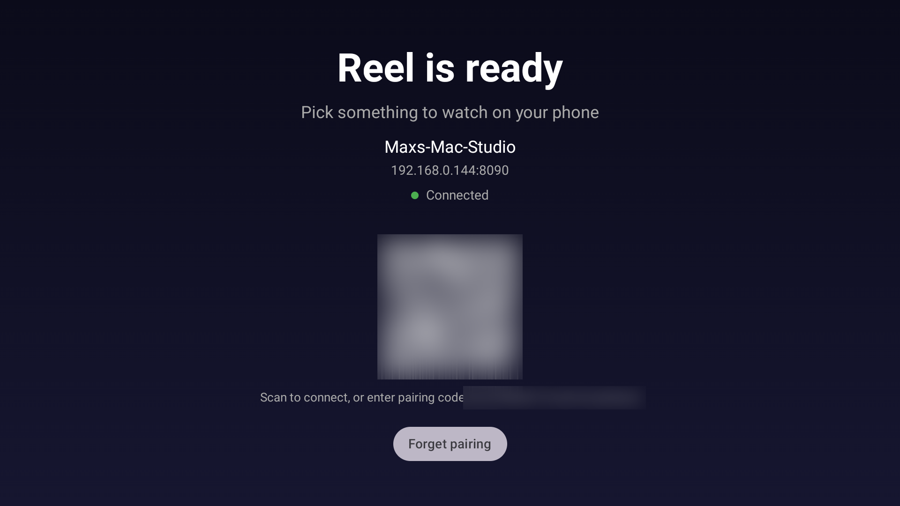

<p align="center">
  <h1 align="center">Reel</h1>
</p>

**Your media folder, on your TV, with your phone as the remote.** Reel turns a Mac into a
little media server for one Fire TV. The TV plays; your phone browses, searches and drives it.
It remembers where you got to, which subtitles you like and how far your wifi stretches.

No accounts, no cloud, no library to curate. Point it at a folder of films and series and
it's ready.

<p align="center">
  
</p>

## What you need

- A Mac that stays awake, with .NET 10, Node and pnpm, and FFmpeg.
- A Fire TV with ADB debugging switched on (Reel's list of what plays as-is is for a
  Fire TV Stick 4K Max), and an Android SDK with Java 17 to build its app.
- A phone on the same network.

## Install

On the Mac, from this repository:

```sh
python3 scripts/service.py install --media "/path/to/media" --url "http://studio.local:8080"
```

This builds everything, installs it under `~/Library/Application Support/Reel`, and starts it
at login. Run it again to update; your progress, favourites and pairing survive.

On the TV:

```sh
adb connect TV_ADDRESS:5555
task tv:install
```

## Three steps in

### 1. Pair

Open Reel on the TV. It finds the Mac by itself and shows a QR code. Scan it with your phone,
then bookmark the page or add it to your home screen.

### 2. Pick something

Browse folders, search, or jump back in from Continue Watching. Favourite things, tag them
and search with `#tag`. Video cards get thumbnails the first time you see them.

### 3. Watch

Now Playing on the phone has play/pause, stop, ±10 seconds, a scrubber with picture
previews, subtitles and quality. The TV remote does play/pause, skips and Back to stop. When
an episode ends, Reel offers the next one.

## Also in the box

- **Plays awkward files.** Anything the TV can't play is converted on the fly, touching as
  little as possible: an old AVI just gets a new container, DTS audio becomes AC3, 10-bit
  video is re-encoded.
- **Weak wifi?** Drop the quality to 1080p, 720p or 480p from the phone.
- **Remembers your choices.** Quality and subtitle language carry over to the next file.
  Subtitles are matched however they're named, including RARBG's `Subs/` folders.
- **Picks up where you left off.** Progress saves as you watch; past 95% counts as watched.

## Running it

```sh
python3 scripts/service.py status
python3 scripts/service.py stop
python3 scripts/service.py start
python3 scripts/service.py uninstall
```

Settings live in `~/Library/Application Support/Reel/appsettings.json`; `stop` then `start`
after editing it. Logs go to macOS logging:
`log show --last 1h --predicate 'process == "logger"'`. Reel keeps its index, progress and
thumbnails in a `.reel` folder inside your media folder, so leave that alone.

Reel is for your home network only. The phone and TV pair with a key that isn't secret on
your network; what Reel guards is that only private-network devices can reach it and only
files inside your media folder are served.

**Stuck on loading placeholders?** Run `status`. If your media is on an external drive, look
for a macOS prompt asking to allow access to a removable volume.

## Development

Run `dotnet tool restore` once, then `task dev` for the API (:8080) and the phone UI (:3000),
with `Reel__MediaRoot`, `Reel__SecretKey` and `Reel__WebUrl` set in the environment or in
`server/Reel.Server/appsettings.Development.json`. `task check` runs every check, and
`task web:rivet` regenerates the API types after a server change. See [CLAUDE.md](CLAUDE.md)
for how the pieces fit together.

## Windows

Reel is built and used on a Mac. The server is plain .NET, so it should mostly work on
Windows, but the installer and live transcoding are Mac-specific. PRs welcome.
